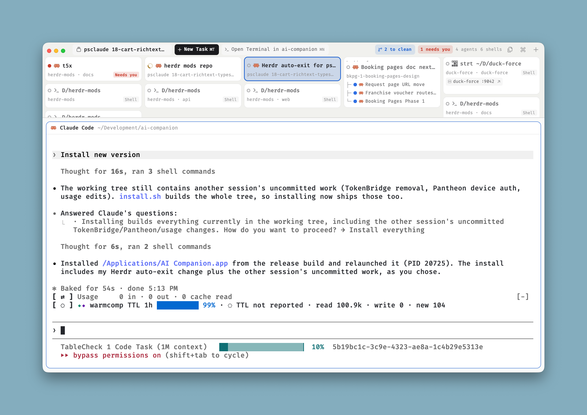

# herdr-mods

My mods and layout for the [Herdr](https://herdr.dev) desktop app.



Each folder is laid out like `~/.config/herdr-app` and has a `RECIPE.md` (what it
is, how it behaves, what it assumes):

```
agent-bar/          mods/agent-bar/      the strip of agent cards at the top
new-task/           mods/new-task/       the ⌘T New Task dialog
  keys.json                               cmd-t
branch-cleanup/     mods/branch-cleanup/ merged/closed/stale branch cleanup
  keys.json                               cmd-shift-b
tasks/              layouts/tasks.json   main without the sidebar, with the bar
skills/herdr-tasks/                       a Claude skill for editing tasks.json
```

## Install

```sh
./install.sh
```

It copies every item into `~/.config/herdr-app` (mods, the `tasks` layout),
merges the `keys.json` bindings into yours without replacing any you already
have, and copies `skills/herdr-tasks/` to `~/.claude/skills/`. Anything it
replaces is backed up under `~/.config/herdr-app/backups/`.

Then check the mods and switch layout:

```sh
for m in agent-bar new-task branch-cleanup; do
  herdr-app check ~/.config/herdr-app/mods/$m
done
herdr-app do layout.switch --name tasks
```

Herdr hot-reloads mod files, so no restart is needed.

## Editing

The live config (`~/.config/herdr-app`) is where Herdr writes and where you try
changes. When you are happy with one:

```sh
./sync.sh
```

It copies each mod and the layout from the live config back into this repo, per
`items.conf`. `keys.json` files and the skill are hand-written here and are not
synced.

## Task chips

The New Task dialog's chips are plain JSON in
`~/.config/herdr-app/tasks.json`, keyed by project (folder name) with `"*"` for
global tasks. The `herdr-tasks` skill (installed with `install.sh`) tells an
agent the format and the safe way to add one; you can also add tasks from the
dialog's **+ Task** form.

## Notes

- The `tasks` layout is a clone of Herdr's `main` 0.1.18; clones do not receive
  Herdr's later changes to `main`.
- `install.sh` overwrites mods it installs. Run `./sync.sh` first if you changed
  them in the live config and want to keep it.
- Mods can run programs (`git`, `gh`, `lsof`, `ps`, `hc`, `open`) — see each
  `RECIPE.md` under **Built from**.

MIT licensed.
